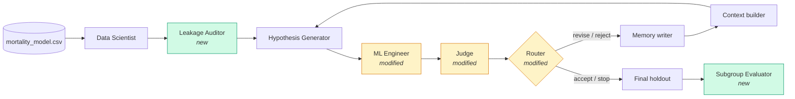
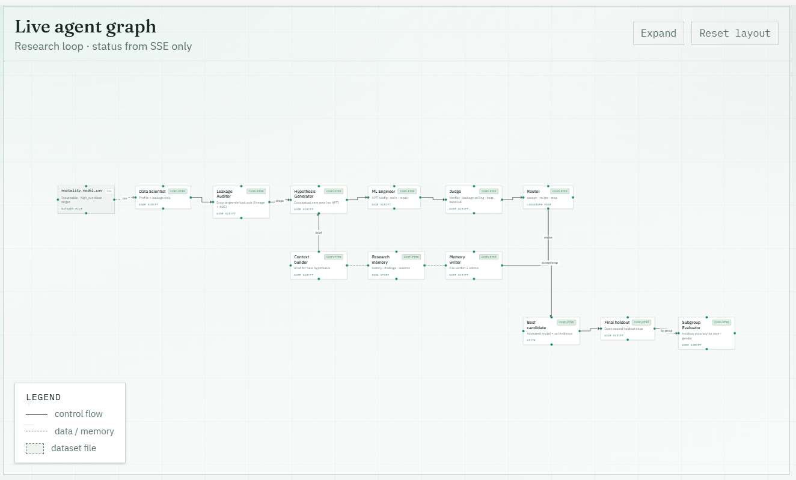
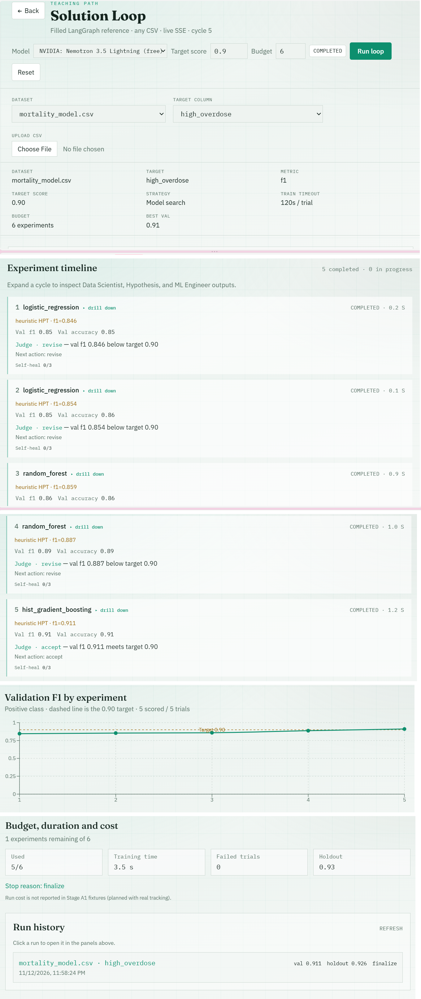

# Week 11: Orchestrated Data Pipeline + Agent ML Workflow

Drug- and alcohol-induced mortality in the US (1999–2022), using CDC WONDER data.
Part 1 is an Airflow pipeline that ingests, cleans, merges, and loads the data into
PostgreSQL and then analyzes it. Part 2 adapts the in-class agent workflow to train
and evaluate a model on the cleaned table.

## Repository layout

```
├── docker-compose.yaml        # Airflow (webserver, scheduler) + 2 Postgres DBs
├── Dockerfile                 # Airflow 2.10.5 image + scikit-learn, matplotlib
├── requirements.txt
├── .devcontainer/devcontainer.json
├── dags/
│   ├── cdc_mortality_dag.py   # the DAG: what runs when (orchestration only)
│   └── mortality/
│       ├── transform.py       # cleaning / harmonizing / merging logic (pure pandas)
│       └── analysis.py        # chart, baseline model, dataset hand-off to Part 2
├── data/raw/                  # CDC WONDER exports (.txt, tab-delimited)
├── output/                    # chart + metrics written by the DAG
├── agents/automl-research-lab/  # Part 2: in-class agent app, modified (see [WEEK11] tags)
└── screenshots/
```

## How to run (Part 1)

Requires Docker Desktop.

```bash
docker compose up -d --build      # first build takes a few minutes
```

1. Open http://localhost:8080 and log in with **admin / admin**.
2. Unpause `cdc_mortality_pipeline` and click **Trigger DAG**.
3. Results: `output/overdose_trends.png`, `output/baseline_metrics.json`, tables
   `mortality_by_group` and `model_metrics` in the warehouse database
   (`localhost:5433`, db/user/password = `mortality`), and the Part 2 hand-off
   `agents/automl-research-lab/datasets/mortality_model.csv` (+ `.lineage.json`).

Stop with `docker compose down` (add `-v` to also delete the databases).

## Data sources

All from [CDC WONDER](https://wonder.cdc.gov), Multiple Cause of Death files, grouped by
state × year × race × gender:

| File                                        | Years      | Content                                                                                   |
| ------------------------------------------- | ---------- | ----------------------------------------------------------------------------------------- |
| `mcd_drug_alcohol_1999_2020.txt`          | 1999–2020 | Deaths by drug/alcohol cause (multiple cause), bridged race                               |
| `mcd_drug_alcohol_2021_2022.txt`          | 2021–2022 | Same, single-race categories                                                              |
| `ucd_drug_alcohol_allcause_1999_2020.txt` | 1999–2020 | Deaths by **underlying** cause, incl. "all other causes" (sums to all-cause deaths) |
| `allcause_2021_2022.txt`                  | 2021–2022 | All-cause deaths, single race                                                             |

## Pipeline structure


```
                  ┌─ [mcd_drug_alcohol]  extract → harmonize_race → pivot_causes ──┐
check_raw_files ──┼─ [ucd_all_causes]    extract → harmonize_race → split ─────────┼→ merge → load_to_postgres ─┬→ make_charts
                  └─ [allcause_2021_22]  extract → harmonize_race ──────────────────┘                           ├→ train_baseline_model
                                                                                                                └→ publish_model_dataset → Part 2
```

**Transformations**

- **Clean:** drop CDC footer notes, rename columns, cast types, and drop CDC's text
  `Crude Rate` ("Unreliable"). Rates are recomputed from deaths ÷ population.
- **Harmonize race:** 2021+ data uses six single-race groups. Asian and Native
  Hawaiian/Pacific Islander are combined into "Asian or Pacific Islander" to match
  1999–2020, and "More than one race" is dropped. Combined groups have their deaths and population **summed** (rates are never averaged).
- **Pivot:** one column per cause, so each state × year × race × gender is one row.
- **Merge:** all-cause deaths for 1999–2022 (UCD totals stacked with the 2021–22
  file) form the spine. Drug/alcohol causes are left-joined onto it with
  `validate="one_to_one"`, so a duplicate key fails the task instead of
  multiplying rows.
- **Load:** 9,229 rows × 32 columns into Postgres table `mortality_by_group`.

**Scheduling and parallelism**

- `schedule="@monthly"`, `catchup=False`: the source files are manual CDC WONDER
  exports (WONDER's API does not provide state-level data), so each monthly run
  reprocesses whatever is in `data/raw/`. Dropping in a newer export updates every
  downstream table and chart on the next run. The load replaces the table, so re-runs
  are idempotent. `retries=2` on every task.
- The **LocalExecutor** runs tasks as parallel processes. The three TaskGroups have
  no dependencies on each other, so they run at the same time, and the three
  downstream tasks (chart, baseline model, publish) also run in parallel after the load.
- Tasks pass only file paths through XCom. The data is staged as CSV in `data/staging/`.

## Analysis results (Part 1)


- Unintentional overdose death rates rose sharply after ~2015 in every group,
  fastest among Black and American Indian/Alaska Native men (≈ 64–72 per 100k by 2022).
- Male rates exceed female rates in every racial group.
- In 1999–2020, drug/alcohol was the underlying cause of 6–11% of all deaths among
  American Indian/Alaska Native people, compared with 1.5–4% for White people.

**Baseline model:** logistic regression classifying whether a group's overdose rate is
above the median (12.7 per 100k). Features: state, race, gender (one-hot), year.
Test accuracy **0.869** (F1 0.868) vs. 0.501 for always predicting the majority class.

## Limitations

- The UCD export covers 1999–2020, so the share-of-deaths metric stops at 2020.

- CDC hides cells with fewer than 10 deaths and flags fewer than 20 as unreliable.
  - Small groups are therefore under-represented (not missing at random), and the model only uses groups with ≥ 20 overdose deaths.
- Bridged race (≤2020) and single race (2021+) are not perfectly comparable.
- MCD counts a death under every drug/alcohol cause listed, so MCD causes are not
  summed. UCD (one underlying cause per death) is used for the share-of-deaths metric.
- 1999–2020 all-cause deaths are the sum of released UCD cells, so they slightly
  undercount groups with suppressed cells.

## Part 2: Agent-based ML workflow

Template: the in-class [automl-research-lab](https://github.com/Kedar-V/automl-research-lab/tree/refactor/lab-solution-layout)

- changes tagged `[WEEK11]` in the code.

### How to run

The Airflow DAG writes `mortality_model.csv` and `mortality_model.lineage.json` into
`agents/automl-research-lab/datasets/`. Then (Docker Desktop running, Git Bash on Windows):

```bash
cd agents/automl-research-lab
cp .env.example .env              # optional: add OPENROUTER_API_KEY for LLM agents
make start-windows                # or make start-mac
```

Open http://127.0.0.1:5173/solution-loop and choose dataset **mortality_model.csv**, target **high_overdose**, target score **0.90**, max cycles **6**, then click Run.

CLI alternative (no UI): `python solution/langgraph/run_cli.py --dataset datasets/mortality_model.csv --target high_overdose --target-score 0.90 --max-cycles 6`

### Modified workflow



| Agent                        | Change           | Why                                                                                                                                                                                                                                                                              |
| ---------------------------- | ---------------- | -------------------------------------------------------------------------------------------------------------------------------------------------------------------------------------------------------------------------------------------------------------------------------- |
| **Leakage Auditor**    | New (plain code) | The published table contains columns built from the same deaths as the target. It drops columns listed in the lineage file from Airflow, plus any column that alone predicts the target with AUC ≥ 0.95.                                                                        |
| **ML Engineer**        | Modified         | The auditor's drops are enforced in code, whatever the LLM proposes. A score ≥ 0.99 can never become the "best" model.                                                                                                                                                          |
| **Judge**              | Modified         | Rejects validation F1 ≥ 0.99 as suspected leakage and requires accuracy above the majority-class baseline. These code checks override an LLM verdict.                                                                                                                           |
| **Router**             | Modified         | A leakage "reject" loops back for another attempt instead of ending the run.                                                                                                                                                                                                     |
| **Subgroup Evaluator** | New (plain code) | Reports holdout accuracy by race and gender, because overall accuracy can hide weak performance on small groups.                                                                                                                                                                 |
| `loop_runtime.py`          | Bug fixes        | Dense one-hot encoding (gradient boosting crashed on the 51-state sparse matrix) and scaled numerics (logistic regression didn't converge). The no-LLM hypothesis now switches model family after one failed capacity increase, instead of retrying logistic regression forever. |
| Live agent graph             | Updated          | `frontend/src/graph/simpleLoopConfig.ts`: two new nodes, new edges, shifted layout.                                                                                                                                                                                            |

### Results

Task: classify whether a state × year × race × gender group has a high unintentional
overdose death rate (> 12.7 per 100k). 3,695 groups, 50/50 classes.

Run without an LLM key (heuristic agents), target score 0.90:

| Cycle | Model chosen by the agents    | Val F1          | Judge                      |
| ----- | ----------------------------- | --------------- | -------------------------- |
| 1     | Logistic regression           | 0.844           | revise                     |
| 2     | Logistic regression, higher C | 0.854           | revise, then switch family |
| 3     | Random forest                 | 0.860           | revise                     |
| 4     | Random forest, more capacity  | 0.886           | revise, then switch family |
| 5     | Hist gradient boosting        | **0.910** | **accept**           |

|                                              | Holdout accuracy | Holdout F1      |
| -------------------------------------------- | ---------------- | --------------- |
| Majority class                               | 0.500            | –              |
| Airflow baseline (Part 1, demographics only) | 0.869            | 0.868           |
| **Agent loop best model**              | **0.926**  | **0.926** |

Both evaluate on the same 739 holdout rows (same split seed). The agent model also uses
the other cause-of-death rates as features, which the auditor cleared.




**Subgroup accuracy (holdout):** White 0.92 (n=433), Black 0.95 (n=245), American Indian/Alaska
Native 0.86 (n=36), Asian/Pacific Islander 0.88 (n=25); female 0.90, male 0.95. The model is
least accurate for the smallest groups, the same groups CDC suppression removes most often.
With n=25–36 these gaps are uncertain.

### Key finding: why lineage matters

- With all columns, every model scores about **0.996**. That's leakage, because the target
  is defined from `mcd_overdose_unintentional_rate`.
- With the lineage file removed, the AUC screen only catches that one column. Logistic
  regression then rebuilds most of the signal from overdose deaths + population and scores
  **0.923**. That's plausible enough that the Judge accepts it. A quiet leak like this
  gets past both statistical checks.
- Only the lineage metadata, which the Airflow pipeline knows because it built the
  columns, catches every leak. Fixed pipelines and adaptive agents work best together:
  the pipeline guarantees provenance, and the agents explore models.
