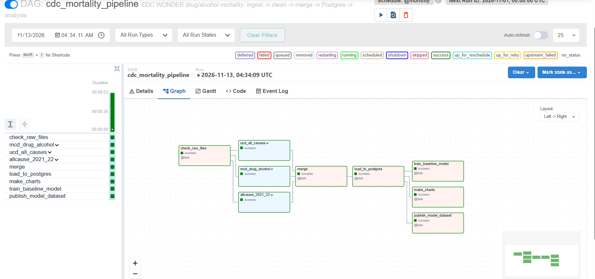
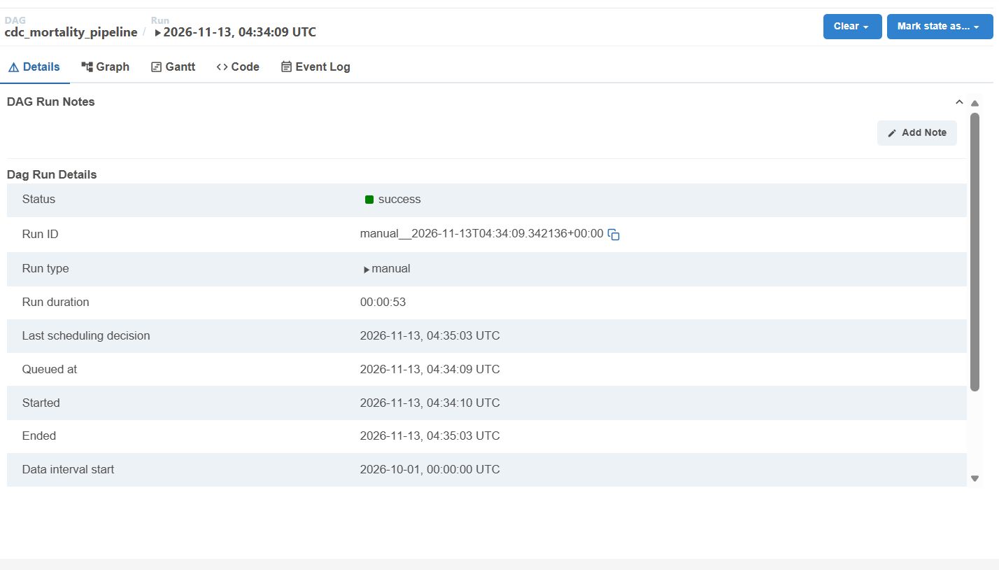
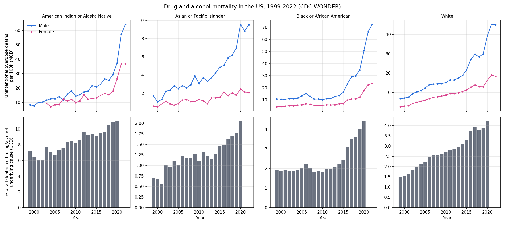

# Week 11: Airflow Pipeline + Agent ML Workflow

US drug- and alcohol-induced mortality, 1999–2022 (CDC WONDER). **Part 1:** an Airflow
DAG ingests, cleans, and merges four CDC extracts, loads them into PostgreSQL, and
analyzes the result. **Part 2:** the in-class LangGraph agent loop, adapted to train and
evaluate a classifier on the cleaned data.

```
dags/                          Airflow DAG + transform/analysis code
data/raw/                      CDC WONDER exports
agents/automl-research-lab/    modified class agent app (changes tagged [WEEK11])
Dockerfile, docker-compose.yaml, .devcontainer/   containerized setup
screenshots/                   Airflow + agent screenshots
```

## How to run

**Part 1 (Airflow).** Requires Docker Desktop.

```bash
docker compose up -d --build
```

Open http://localhost:8080 (admin / admin), unpause `cdc_mortality_pipeline`, and trigger it.
Outputs: `output/overdose_trends.png`, `output/baseline_metrics.json`, Postgres table
`mortality_by_group` (localhost:5433, user/password/db `mortality`), and
`agents/automl-research-lab/datasets/mortality_model.csv` for Part 2.
Stop with `docker compose down`.

**Part 2 (agents).** Run after Part 1, from Git Bash:

```bash
cd agents/automl-research-lab
make start-windows        # or: make start-mac
```

Open http://127.0.0.1:5173/solution-loop and run with dataset `mortality_model.csv`,
target `high_overdose`, target score `0.90`, max cycles `6`.
CLI alternative: `python solution/langgraph/run_cli.py --dataset datasets/mortality_model.csv --target high_overdose --target-score 0.90 --max-cycles 6`

## Part 1: Pipeline

```
                  ┌─ [mcd_drug_alcohol]  extract → harmonize_race → pivot_causes ─┐
check_raw_files ──┼─ [ucd_all_causes]    extract → harmonize_race → split ────────┼→ merge → load_to_postgres ─┬→ make_charts
                  └─ [allcause_2021_22]  extract → harmonize_race ────────────────┘                           ├→ train_baseline_model
                                                                                                              └→ publish_model_dataset
```

**Data:** four CDC WONDER extracts, grouped by state × year × race × gender. They contain
drug/alcohol deaths by cause (1999–2022), deaths by underlying cause including all other
causes (1999–2020), and all-cause deaths (2021–2022).

**Transformations:**
- **Clean:** drop footer notes, cast types, and recompute rates from deaths ÷ population.
- **Harmonize race:** combine 2021+ single-race groups into the 1999–2020 categories,
  summing deaths and population rather than averaging rates.
- **Pivot:** one column per cause, so each group is one row.
- **Merge:** left joins with `validate="one_to_one"`, giving 9,229 rows loaded into Postgres.

**Scheduling and parallelism:**
- `@monthly`, `catchup=False`, `retries=2`. The sources are manual CDC exports (WONDER's
  API has no state-level data), so each run reprocesses `data/raw/`. A newer export
  updates everything downstream.
- Loads replace the table, so re-runs are idempotent.
- The LocalExecutor runs the three TaskGroups in parallel, then the three downstream tasks
  in parallel.
- XCom passes only file paths, not data.

**Results:**
- Unintentional overdose death rates rose sharply after ~2015 in every group, reaching
  ≈ 64–72 per 100k among Black and American Indian/Alaska Native men by 2022.
- Men's rates exceed women's in every group.
- In 1999–2020, drug/alcohol was the underlying cause of 6–11% of all deaths among
  American Indian/Alaska Native people, compared with 1.5–4% for White people.
- Baseline logistic regression (predicting whether a group's overdose rate is above the
  median): **0.867 accuracy**, vs 0.50 for always predicting the majority class.





## Part 2: Agent modifications

Template: [automl-research-lab](https://github.com/Kedar-V/automl-research-lab/tree/refactor/lab-solution-layout).

| Agent | Change |
|---|---|
| **Leakage Auditor** (new) | Drops columns derived from the target, using a lineage file published by Airflow plus a single-feature AUC screen |
| **ML Engineer** | Enforces the auditor's drops in code. Leak-like scores (≥ 0.99) never become "best" |
| **Judge** | Rejects F1 ≥ 0.99 as leakage and must beat the majority-class baseline. Code checks override the LLM |
| **Router** | A leakage "reject" loops back instead of ending the run |
| **Subgroup Evaluator** (new) | Holdout accuracy by race and gender |
| `loop_runtime.py` | Fixed a gradient-boosting crash (sparse one-hot) and added feature scaling. Hypothesis now switches model family after one failed capacity increase |
| Live graph | `frontend/src/graph/simpleLoopConfig.ts` updated with the new nodes |

**Results:** the loop tried logistic regression (val F1 0.846 → 0.854), then random forest
(0.859 → 0.887), then gradient boosting (0.911), and accepted the last.

| Model | Holdout accuracy |
|---|---|
| Majority class | 0.500 |
| Airflow baseline | 0.867 |
| **Agent loop (gradient boosting)** | **0.926** |

Subgroup accuracy was lowest for the smallest groups: American Indian/Alaska Native 0.86
(n=36) and Asian/Pacific Islander 0.88 (n=25), vs 0.92–0.95 for the others.


## Key findings

- **Leakage:** with all columns, every model scores about 0.996, because the target is
  defined from one of them. Without the lineage file, a quieter leak (overdose deaths +
  population) scored 0.923 and passed the Judge. Only the pipeline's lineage metadata
  caught every leak.
- **Fixed pipeline vs adaptive agents:** they work best together. Airflow guarantees
  provenance; the agents explore models.

**Limitations:**
- CDC suppresses counts under 10, so small groups are under-represented.
- Bridged-race (1999–2020) and single-race (2021+) categories are not fully comparable.
- The underlying-cause export covers 1999–2020, so the share-of-deaths metric stops at 2020.
